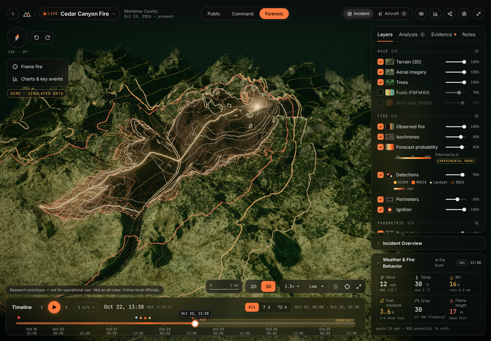
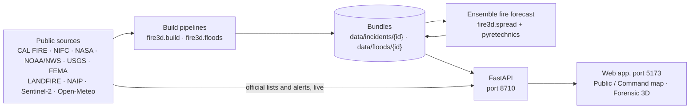
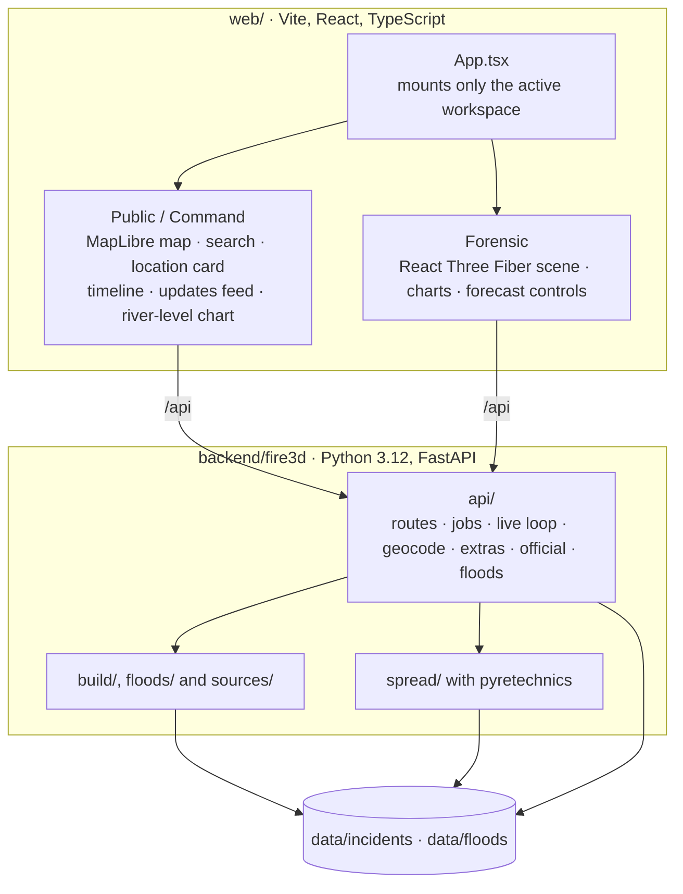

# Disaster Mapping

**Maps of wildfires and floods in the lower 48 US states, built on real public data.**

Disaster Mapping is a web app that you run on your own computer. It shows the wildfires and the floods that US
agencies are reporting right now, and past ones, on one map of the 48 contiguous states (and Washington, DC). For each
fire or flood it gathers what is known from official and scientific sources and lays it out in three views: a simple
one for the public, a dense one for emergency managers, and a 3D one for close study.

- **Wildfires:** where each fire is and how big, its agency record, how it spread (from satellite heat detections and
  mapped perimeters), the official warnings and evacuation orders near it, and an experimental forecast of where it
  could spread in the next three days.
- **Floods:** the National Weather Service's flood warnings, the river gauges at flood stage, the river levels and the
  official river forecasts, the water seen by satellite, and the areas that NWS forecasts may flood.

It is a **research prototype, not for operational use**. It was called **Fire-3d** until November 2026 (see
[About the name](#about-the-name)).

> [!IMPORTANT]
> Model output in Disaster Mapping is experimental. It is not an evacuation instruction and it is not official
> information. A place with no marker, no warning or no water on the map is **not** an all-clear: outside what was
> measured or modeled, the situation is unknown. Always follow local officials.

## Contents

- [Screenshots](#screenshots)
- [A few words explained](#a-few-words-explained)
- [What is official, what is measured, what is experimental](#what-is-official-what-is-measured-what-is-experimental)
- [The three views](#the-three-views): [wildfires](#wildfires-in-each-view) and [floods](#floods-in-each-view)
- [Using the map](#using-the-map)
- [Run it on a Mac, step by step](#run-it-on-a-mac-step-by-step)
- [How it works](#how-it-works)
- [The fire forecast and how good it is](#the-fire-forecast-and-how-good-it-is)
- [Known limits](#known-limits)
- [Troubleshooting](#troubleshooting)
- [Data sources, licenses and credits](#data-sources-licenses-and-credits)
- [Where to read more (docs map)](#where-to-read-more-docs-map)
- [About the name](#about-the-name)

## Screenshots

Taken on November 5, 2026.


| Floods on the national map | A fire in the Public view |
|---|---|
|  |  |

| A flood in the Public view | A flood in Command |
|---|---|
|  |  |

| A fire in Command | Forensic: a fire in 3D |
|---|---|
|  |  |


## A few words explained

You do not need to know wildfire science, hydrology or 3D maps to use the app. These are the words it uses most:

| Word | Meaning |
|---|---|
| **Perimeter** | The outline of a fire as an agency mapped it (often from an aircraft), with the time it was mapped. |
| **Satellite heat detection** | A spot where a satellite saw unusual heat. Each one covers a square of 375 m to 2 km, so it shows roughly where the fire burned, not its exact edge. |
| **Fuels** | The vegetation that can burn (grass, shrubs, timber, leaf litter), from the national LANDFIRE maps. |
| **Spread model, ensemble** | A computer simulation of how a fire grows with the wind, slope and fuels. The app runs it 31 to 51 times with slightly different weather (an *ensemble*) and shows how many runs reached each spot. |
| **Hindcast** | A forecast made afterwards for a past fire, from a past moment, to see how well the model would have done. |
| **NWS product** | A message from the National Weather Service: a **Warning** (flooding is happening or about to), a **Watch** (flooding is possible), an **Advisory** (minor flooding) or a statement that updates one of them. |
| **River gauge, stage, flood stage** | A gauge measures the water level of a river (its *stage*, in feet). NWS sets levels for each gauge: action, minor, moderate and major flood stage. |
| **River forecast, crest** | The NWS forecast of a gauge's level for the next days; the *crest* is the highest level it forecasts. |
| **Hydrograph** | A chart of a river's level (or flow) over time: what was measured, then the forecast. The app calls it the river-level chart. |
| **Water seen by satellite** | Water mapped from a satellite image (NASA OPERA). It includes the river's normal water, and clouds or trees can hide flood water. |
| **Floodplain** | FEMA's map of the land with a 1 % chance of flooding in any year (the "100-year" floodplain). It is a planning map, not today's flood. |
| **Terrain, 3D** | The shape of the ground (from USGS elevation data). In 3D the map is tilted so hills and valleys show. |
| **Basemap** | The background map: dark, roads, or aerial photos. |

## What is official, what is measured, what is experimental

The app keeps three kinds of information apart and labels each one.

| Kind | Fires | Floods | How the app shows it |
|---|---|---|---|
| **Official** (from the agency in charge) | the agency's fire record (CAL FIRE in California, otherwise the protecting agency via NIFC); evacuation orders and warnings from local officials (California and Oregon); NWS Red Flag Warnings and Fire Weather Watches; local officials' alerts relayed by the NWS | NWS flood products; NWS flood categories and river forecasts; FEMA flood zones; evacuation orders (California and Oregon) | word for word, with the issuer, the issuer's own times and a link; never merged with model output. A missing official item is never an all-clear. |
| **Measured** (by an instrument, possibly hours or days old) | satellite heat detections; satellite images | river stage and flow (USGS, provisional); water seen by satellite (NASA OPERA) | with the time of the measurement and its age; "no water" or "no detection" in an image is not proof of no flooding or no fire |
| **Estimate or experimental model** | the burned area reconstructed from detections and perimeters (an estimate); the spread forecast (Disaster Mapping's own experimental model) | NWS's forecast flooded-area and category maps (labelled experimental by NWS); NOAA's National Water Model (experimental, Command and Forensic only) | labelled "Estimate", "Model" or "experimental"; never an evacuation instruction |

Every view keeps the lines "Research prototype — not for operational use" and "Not an all-clear. Follow local
officials." Disaster Mapping has no flood model of its own.

## The three views

The switch in the middle of the top bar reads **Public · Command · Forensic**, and the switch beside the logo reads
**Fires | Floods**. Public and Command share one 2D/3D map; Forensic is a separate 3D scene. Switching views keeps the
open fire or flood, the time, your selected point and the map's heading.

### Wildfires in each view

**The national map (Fires).** One marker per fire at the agency's reported location, sized by its acreage (filled
orange: an agency lists it as active). Crowded fires are grouped ("28 FIRES"); zooming in splits them. Filters:
Active (every fire listed as active right now, whatever its size), 2026 season (active fires plus this year's fires of
300 acres or more; the default) and 2025. Prescribed burns are never listed. In California the fire list and each
record come from CAL FIRE; everywhere else (and for the California fires CAL FIRE does not list) from the national
interagency list, NIFC WFIGS. "Show details" adds the fire list with the National Weather Service's Red Flag Warnings
and Fire Weather Watches ("Official now · lower 48 states"), the readout, the scale and the legend. Under the list:
"Only fires reported to CAL FIRE or NIFC are listed; a place with no marker is not an all-clear." Nothing is opened or
prepared by itself.

**Public (the default).** Clicking a fire opens its fire view: a round "hazard circle" with the agency record's status
(ACTIVE, CONTAINED, DECLARED OUT, …) and the fire's name, the official facts as "value — LABEL" rows (burned,
contained, started, reported location, NWS fire weather, evacuation zones, a local officials' alert while one is in
effect, last official update), a chip that tells you how far you are once you choose to share your location, and the
newest agency perimeter on the map (aerial photos by default). There is no model output here: "MORE IN COMMAND ›" opens
it. A fire that is not prepared yet offers **Prepare map data (1-3 min)**.

**Command (for emergency managers).** The same map, denser, on the dark basemap: the selected point's readout on the
left (coordinates in decimal, degrees-minutes-seconds and UTM; inside or near the mapped fire, with its age; the model's
figure, run and arrival times; official information), "Official now" on the right (one-line rows that open to the full
official wording), the observed fire coloured by when it burned, perimeters, satellite detections and the modeled
spread on the map, a slim timeline, the updates feed, and a data-status block with the newest time of each source.
Times use the 24-hour clock in the fire's own time zone. Zooming in on a prepared fire (from about zoom 8.5) shows its
spread without a click; clicking a marker opens the fire's card with **Prepare analysis (1-3 min)** when it is not
prepared yet.

**Forensic (3D).** The fire on 3D terrain with aerial photos, in three visual styles (hybrid, realistic, parametric):
the observed fire with lines of equal arrival time, burn severity and fuels; the forecast as a probability field with
10 / 50 / 90 % contours; detections, perimeters, trees, smoke, embers and wind; the full timeline with key events and
your own notes; charts of burned area, rate of spread and an elevation profile; forecast controls (start time, 24 / 48
/ 72 h, the weather ensemble) with hindcast scores for past fires; Evidence and Notes tabs; and live firefighting
aircraft from open ADS-B data (live fires only).

**What the fire facts mean, in more detail.**

- **Where each fire's record comes from.** In California, CAL FIRE's list is the record; NIFC WFIGS (which carries
  each protecting agency's own numbers) adds the California fires CAL FIRE does not list. A California fire counts as
  active if either agency says so, and its card shows each agency's record with its own issuer, status and time when
  they differ. Outside California every record is the protecting agency's (for example "USFS (USDA Forest Service)
  via NIFC WFIGS"), with a link to the record.
- **Evacuations.** Orders and warnings from local officials within 15 km of the fire, with their distance: via Cal OES
  in California and Oregon's Department of Emergency Management (OEM) in Oregon, current status only. In every other
  state the row says "Not available in this state (Montana)": Disaster Mapping found no free, official,
  machine-readable state feed there.
- **The fire's record.** CAL FIRE's record in California, with every change Disaster Mapping has recorded since it
  started checking (for example "CAL FIRE: 50 % contained (was 25 %)", with CAL FIRE's own update time); elsewhere the
  protecting agency's record via NIFC WFIGS, with the record's own update time.
- **Fire weather.** NWS Red Flag Warnings and Fire Weather Watches in the NWS's own words, drawn as outlines. For a
  past fire they come from an archived copy (Iowa Environmental Mesonet) and are labelled so.
- **Local officials' alerts.** Messages that local officials send through the NWS (Fire Warning, Evacuation Immediate,
  Shelter In Place Warning and similar), quoted word for word with the sender and time. For past days they come from
  FEMA's public IPAWS archive, labelled "FEMA archive". Most local alerts are never relayed by the NWS, so "none here"
  is never an all-clear.
- **Check a location.** The "Check an address" box takes a US street address, a town, county or ZIP code, pasted
  coordinates or a fire's name; you can also click the map. Inside a fire the location card says, in four short parts,
  whether the point is near or inside the mapped fire, which official orders or alerts cover it, what the experimental
  model says ("In the experimental model, 0 of 31 simulated fires reached here by … (72 h). Not a safety guarantee."),
  and how old the data are. Outside the area the model covers it says "Unknown, not low."
- **How good is the model here?** Each fire carries an accuracy label for its region, from tests on past fires (see
  [the forecast section](#the-fire-forecast-and-how-good-it-is)). Where no fire was tested it says "Accuracy not yet
  tested here."
- **Times in the fire's own zone.** Every time is shown in the fire's local time zone with its abbreviation, for
  example "3:40 PM MDT" in Public and "15:40 MDT" in Command and Forensic.

### Floods in each view

**What a "flood" is here.** Disaster Mapping groups, per river or area, the NWS flood products in effect (Flood
Warning, Flash Flood Warning, Flood Watch, Flood Advisory and their statements) and the river gauges at minor, moderate
or major flood stage, and names each group, for example "Rio Grande flood" or "Ducktown flash flood". A gauge at flood
stage that no NWS product names is listed too ("No NWS flood product names this gauge right now."). Flood watches are
hidden until you turn on "Show watches". Coastal and lakeshore flood products are not read. Past years (2026, 2025)
list the river floods that reached or were forecast to reach moderate or major stage at an NWS gauge and the flash
floods NWS tagged considerable, catastrophic or an emergency, from the Iowa Environmental Mesonet's archive of NWS
products. Everything works without any key.

**The national map (Floods).** Each flood is a blue ring with a dot coloured by its NWS flood category or product; the
larger ones are named with their category and river stage. "Show details" adds the flood list (Active, 2026, 2025) with
"Official now" (the number of NWS flood products in effect). "Only floods with an NWS flood product or a river gauge at
flood stage are listed. A place with no marker is not an all-clear."

**Public.** The place and dates, a water circle with the NWS product as its status ("FLOOD · WARNING", "FLASH FLOOD ·
EMERGENCY"), and seven plain facts: for a river flood, the NWS forecast flooded area, the river stage at the main gauge
(measured by USGS) and the NWS forecast crest; for a flash flood, how NWS detected it and the damage threat it states;
then the NWS products in effect, evacuations and the last official update. The map shows the NWS warning areas (pink),
NWS's forecast flooded area (hatched), the river gauges as diamonds coloured by flood category, the main channel and the
water seen by satellite. FEMA's 100-year floodplain is a background layer you can turn on. The model never appears in
Public.

**Command.** A dense readout of the selected point (which layers cover it, the nearest gauge, its stage, category and
forecast), "Official now" with every NWS product word for word, the river forecast, evacuations and local officials'
messages, and the **river-level chart**: measured stage or flow, the NWS forecast, the NWS flood levels and, on the flow
axis, NOAA's National Water Model as a separate, dotted, experimental line. Dragging the chart's handle shows the NWS
products in effect at that time. NWS category flood maps, the FEMA floodplain and the model's flooded area are layers
you can turn on (all off by default).

**Forensic (3D).** **Prepare 3D data (about 1 min)** builds the flood's terrain bundle; then the flood layers are draped
on 3D terrain, the gauges stand as bars (bar height is the river stage, scaled, not water depth), the Evidence tab keeps
every saved version of each NWS product, and the river-level chart sits in the dock. 3D data is prepared for current
floods only (NWS's forecast maps, the model and river forecasts are not kept for past dates).

**Try floods without the network.** `cd backend && uv run python scripts/make_fixture.py --only flood` writes
`fixture-flood`, a synthetic "Ridge Fork River flood" in New Mexico with fictional issuers ("NWS Example Office
(synthetic)"); open it at `/?flood=fixture-flood` (it is marked DEMO and is never listed with real floods).
`scripts/serve_fixture.py` also serves seven synthetic demo floods (flash flood emergency, watch only, past, …).

## Using the map

- **Layers & settings.** The layers button (top right) opens a drawer with the basemap (dark, roads, or aerial photos
  with labels), the layers you can turn on (official evacuation zones, public cameras in California, recent satellite
  images; for floods the water layers, the FEMA floodplain and, in Command, the model), the units (US or metric) and a
  **Display** section.
- **Zoom dimming (off by default).** In the Display section, the "Zoom dimming" switch darkens the map's edges more as
  you zoom in, like the rim of a globe, so the middle stays bright. It starts off; your choice is remembered in this
  browser. The soft shading behind the panels' text stays either way, so the text stays readable.
- **2D and 3D.** A flat map, or tilted 3D terrain. In 3D, buttons tilt the view; "Top-down" and "North up" reset it.
  From zoom 15, plain 3D building shapes from OpenStreetMap appear (today's buildings: not a damage assessment).
- **Turning the map** (all views, 2D and 3D): press `Q` or `E` (15° left or right) or the ⟲ ⟳ buttons beside the
  compass; drag the compass; or right-drag, Ctrl + drag, or twist two fingers on a touch screen or a Safari trackpad.
  `N` or a click on the compass turns north up.
- **Your location.** "Use my location" and the distance chip ask your browser for your location only when you click.
  It stays in your browser (never in the link, never stored) until you choose "Check this spot".
- **Keyboard and phone.** `/` focuses the search box, `H` hides the panels, `Space` plays a fire's timeline and the
  arrow keys step it (Shift: 6 hours). On the map, the arrow keys pan, `+` and `-` zoom and Shift + arrows rotate.
  Reduced-motion settings are respected. On phones the panels become bottom sheets.
- **Links.** The address bar keeps the view, so a link opens the same thing: `?incident=2025-eaton-fire-dbfa57`,
  `?flood=<id>`, `&preset=command`, `&ws=forensic`, `&persp=3d`, `&basemap=dark|roads|aerial`, `&units=metric`,
  `&hazard=flood`, `&view=<lon>,<lat>,<zoom>[,<bearing>,<pitch>]` and `&sel=<lat>,<lon>`. A link to an unknown fire
  or flood falls back to the national map with a notice.

## Run it on a Mac, step by step

The app runs on your own computer: a Python server (the "API", which fetches and prepares the data) and a web page that
you open in your browser. These steps take about 10 minutes the first time, plus downloads.

### 1. Install the tools (once)

Open the **Terminal** app and run:

```bash
xcode-select --install          # Apple's command-line tools, with the C compiler (skip if already installed)
curl -LsSf https://astral.sh/uv/install.sh | sh   # uv, which installs Python 3.12 and the backend's packages
```

Then install **Node.js 22.12 or newer** (with npm) from <https://nodejs.org/> (the LTS installer), or with Homebrew:
`brew install node`. Close and reopen Terminal so it finds the new tools; `uv --version` and `node --version` should
both answer.

Why these: the fire-spread engine (pyretechnics) is compiled from source the first time (about 45 s, which needs the C
compiler); uv also installs Python 3.12, which the backend requires; Vite 8 needs Node `^20.19 || >=22.12` and the test
runner Vitest 5 needs `^22.12 || ^24 || >=26`. You also need about 1 GB of free disk for `data/` (each prepared fire is
10–30 MB, each flood a few MB, and the shared download cache grows to a few hundred MB) and a browser with WebGL2 (any
recent desktop browser; Google Chrome is needed only for the screenshot script).

### 2. Get the code and install its packages

```bash
git clone https://github.com/gz1010/disaster-mapping.git
cd disaster-mapping
(cd backend && uv sync --frozen)   # creates backend/.venv from uv.lock; compiles pyretechnics the first time
(cd web && npm ci)                  # installs the exact versions in web/package-lock.json
```

The repository was called `gz1010/fire-3d` until November 2026; the old address redirects. If you already have a copy
(for example in a folder called `Fire-3d`), you can keep using it: `git remote set-url origin
https://github.com/gz1010/disaster-mapping.git` points it at the new address, and `git pull` updates it.

### 3. Optional: keys for more satellite data (`.env`)

Everything works without any key. Two free NASA keys add data. Put them in a file named `.env` in the repository's top
folder (create it with any text editor), one per line, then run `chmod 600 .env` so only you can read it:

```ini
FIRMS_MAP_KEY=<your key>
EARTHDATA_TOKEN=<your token>
```

- **`FIRMS_MAP_KEY` (fires).** Without it the app uses NASA's free download files: Suomi NPP VIIRS and MODIS for 2025
  fires, and the last 7 days of VIIRS and MODIS for live fires. A free NASA FIRMS `MAP_KEY` unlocks the FIRMS area
  service, which adds GOES (fire timing to within minutes), Landsat and, for 2025 fires, the NOAA-20 and NOAA-21 VIIRS
  satellites. Request one at <https://firms.modaps.eosdis.nasa.gov/api/map_key/> (limit: 5,000 transactions per
  10 minutes; Disaster Mapping throttles itself to 150 requests per 10 minutes).
- **`EARTHDATA_TOKEN` (floods).** Without it "Water seen by satellite" comes from NASA's public optical images
  (Landsat and Sentinel-2 through NASA Earthdata GIS), which cannot see through clouds, and the app says "No radar
  images: NASA login not set up". A free NASA Earthdata user token adds the radar images (OPERA DSWx-S1, which see
  through clouds) and the newest optical day. To get one: create a free account at <https://urs.earthdata.nasa.gov/>
  and choose **Generate Token** (valid for about 60 days; note the date); then sign in once at
  <https://search.earthdata.nasa.gov/> and download any one OPERA DSWx file, so NASA's PO.DAAC archive is approved for
  your account. When the token expires the app says the login was refused; generate a new one. The token path has been
  tested with a fake token and a simulated server only.

Only `backend/fire3d/config.py` reads `.env` (a real environment variable of the same name takes precedence).
`.gitignore` already excludes `.env` and `.env.*`, so the keys are never committed; the app masks them as `***` in
logs and error messages; the Earthdata token is sent only to `archive.podaac.earthdata.nasa.gov` (never to another host,
never in a URL) and never written to a file. Never paste a key into code, issues, chats or screenshots.

### 4. Start the app

```bash
./dev.sh --no-live     # quiet start: API on http://127.0.0.1:8710, web app on http://localhost:5173
```

Open <http://localhost:5173> in your browser. Press `Ctrl-C` in Terminal to stop both servers.

| Command | What it starts |
|---|---|
| `./dev.sh --no-live` | the API without the live loop or automatic preparation (best for a first look) |
| `./dev.sh` | the API with the live loop: every 15 minutes it checks CAL FIRE and NIFC WFIGS (recording each change of a CAL FIRE fire's acres, containment and status), refreshes the prepared live fires and re-forecasts them when needed, and refreshes the flood lists and the prepared current floods; right after startup it also prepares up to 4 active fires from anywhere in the lower 48 (at least 100 acres, with detections in the last 48 h, the most active first), one at a time |
| `./dev.sh --reload` | the API restarts when backend code changes; live auto-build is off, because a restart would kill builds in progress |
| `./dev.sh --fixture` | a small fixture server (`backend/scripts/serve_fixture.py`) that lists and serves only the bundles already on disk, with fake build and forecast jobs and synthetic aircraft; address search and the optional sources need the real API |

Ports: the API uses **8710** and the web app **5173** (Vite's default in `web/vite.config.ts`, which passes `/api` on to
the API). Change them with `API_PORT=… WEB_PORT=… ./dev.sh`. Port 8000 is never used: `dev.sh` refuses it, because
another local app owns it on the development machine.

### 5. The first run: what to expect

- **The app opens on the national map** with the fires from CAL FIRE's and NIFC's lists (switch to Floods for the
  floods). A fresh copy has no prepared data (`data/` is not in the repository), so a fire offers **Prepare map data**
  (Public) or **Prepare analysis** (Command), and a flood's Forensic view offers **Prepare 3D data**. These buttons are
  the only way the map views start a download; with `./dev.sh` (live loop on) the backend also prepares up to 4
  active fires by itself.
- **Preparing a fire takes about 1–3 minutes**, mostly downloads (measured: Eaton 69 s, Palisades 75 s, Madre 87 s and
  Camino 192 s; the live Henderson and Norte fires 57 s and 47 s, and the live Cyrus Fire 159 s, each including its
  first forecast). The 12 test fires outside California took 30 s to about 9 minutes when every weather host answered,
  and up to 22 minutes while one did not (docs/validation.md, section 10.3). Rebuilds with a warm cache are much faster.
  **A forecast takes about 2–30 seconds** (31–51 model runs over 72 h on a 12-core laptop). **A flood's 3D data takes
  about 1 minute.**
- **To try it without downloads**, create the synthetic demo data (about 30 s), then open it by its address (demo
  items are in no agency's list, so the national map does not show them; the app labels them "Demo · simulated data"):

  ```bash
  (cd backend && uv run python scripts/make_fixture.py)              # fixture-demo and fixture-live (fires)
  (cd backend && uv run python scripts/make_fixture.py --only flood) # fixture-flood
  (cd backend && uv run python scripts/make_fixture.py --only east)  # optional: fixture-east, a small fire in North Carolina
  # then open http://localhost:5173/?incident=fixture-live  or  http://localhost:5173/?flood=fixture-flood
  ```

### 6. Other settings and files

- **Settings.** `FIRE3D_DATA_DIR` and `FIRE3D_CACHE_DIR` (where data goes, default `data/` and `data/cache/`),
  `FIRE3D_LIVE`, `FIRE3D_AUTO_BUILD_LIVE`, `FIRE3D_LIVE_INTERVAL_S` (backend) and `VITE_API_TARGET` (where Vite sends
  `/api`). The `FIRE3D_` prefix is the app's internal name and stays (see [About the name](#about-the-name)). The
  optional `FIRE3D_NWS_CONTACT` (a website or email address) is added to the User-Agent of National Weather Service
  requests only; unset, the app identifies itself as "Disaster-Mapping/0.1 (research prototype)" with no personal
  contact.
- **Data you cannot download again.** `data/official/calfire/` holds the CAL FIRE change history (one JSON-lines file
  per fire). CAL FIRE's lists keep only the latest record, so this history exists only because the app recorded it
  whenever it checked CAL FIRE (since Oct 18, 2026). Keep it when you clean up `data/`; the bundles in
  `data/incidents/` and `data/floods/` and the download cache in `data/cache/` can be rebuilt.
- **Town and ZIP search index.** `backend/fire3d/data/gazetteer_us.json` (3.8 MB: about 32,400 towns and places, every
  county (3,222) and about 33,800 ZIP areas) is built from the U.S. Census Bureau 2026 Gazetteer Files. To rebuild it:
  `cd backend && uv run python scripts/build_gazetteer.py [--year 2026]`, or `--source DIR` to use files already
  downloaded. Without it, street addresses still work, but town and ZIP searches fail (the API answers 503).
- **Region files.** `backend/fire3d/data/us_states.geojson`, `us_counties.geojson` and `us_timezones.geojson` (about
  2 MB together, simplified) give the state, county and time zone at any point without a network request. They are
  built from Census TIGERweb and the USDOT time-zone layer by `uv run python scripts/build_us_regions.py`. If they are
  missing, place lookups answer "unavailable" (HTTP 503) and times fall back to UTC (labelled), never to Pacific time.

### 7. Checks

```bash
(cd backend && uv run pytest -q)    # offline backend tests
(cd web && npm run typecheck && npm run lint && npm test && npm run build)
(cd web && node scripts/shot.mjs "http://localhost:5173/?incident=fixture-demo" /tmp/disaster-mapping.png --wait 8000)   # screenshot with the installed Chrome
```

## How it works



1. **Lists.** NIFC WFIGS's national lists and CAL FIRE's incident lists give the active fires and the fires of a year
   (wildfires only, lower 48 and DC; in California CAL FIRE's record wins and WFIGS adds the fires CAL FIRE does not
   list). NASA FIRMS's public 24-hour feeds count recent detections near each fire. Every time the backend checks CAL
   FIRE, it appends any change of a fire's acres, containment or status, with CAL FIRE's own update time, to
   `data/official/calfire/`. Floods come from the NWS flood products in effect and NOAA's river gauges at flood stage
   (past years from the Iowa Environmental Mesonet's archive). The offline region files give each item's state, county
   and time zone.
2. **Preparing a fire** (`fire3d.build.pipeline`). The app chooses an *analysis area* around the fire: a square in the
   fire's UTM zone (10 to 19 across the lower 48), sized to the fire. It downloads elevation (USGS 3DEP), fuels and
   canopy (LANDFIRE: the pre-fire edition, LF2023 to LF2025; where LF2025 has no data yet, parts of the South and East,
   the previous edition), an aerial photo (NAIP) and burn severity (Sentinel-2 dNBR). Outside California the fire's
   agency perimeters are matched by its IRWIN id. From satellite detections and perimeters it reconstructs when each
   cell burned (an *arrival-time* map), plus hourly burned area and key events. For live fires it also asks NASA's
   catalog of satellite passes (CMR) whether later passes over the fire saw nothing, which sets the latest
   observation. Finally it fetches weather for a 4 × 4 grid of points (Open-Meteo) and, for live fires, runs a first
   forecast.
3. **Preparing a flood** (`fire3d.floods.build`). The flood's terrain (USGS 3DEP), aerial photo (NAIP) and frozen copies
   of the official water layers: NWS warning areas and product versions, river gauges and their series, NWS forecast
   and category maps, FEMA flood zones, the National Water Model and the water seen by satellite. Since November 2026
   it also keeps the flood's **time history** (`timeline.json`): every satellite pass over the flood's area in its time
   window, oldest first, each with its own date and how much of the area it could see (passes that saw nothing for
   clouds or missing data are listed as "no view", never as dry land), and every version of every NWS product of the
   flood's events with its own issue and end times (NWS's live copies plus the Iowa Environmental Mesonet's archive).
   Nothing is filled in between two passes. And it makes three **3D terrain products** for the Forensic view: the
   ground's relief around the water (it sets the automatic height boost, for example ×10 on flat ground), the height
   above the nearest river channel (from the terrain and NOAA's National Water Model river lines; not a flood map) and
   an estimated water depth inside the mapped water only (the published FwDET method, Cohen et al. 2018 and 2019: the
   water surface is taken from the terrain height at the water's edge; experimental).
4. **Bundles.** Everything lands in `data/incidents/<id>/` or `data/floods/<id>/`: `manifest.json`, raw grids, JSON
   files and, for fires, one folder per forecast run (arrival-time quantiles, burn probability and flame length). Fire
   ids look like `2025-eaton-fire-dbfa57` (year, name and the start of CAL FIRE's or the fire's IRWIN id); flood ids like
   `flood-20261104-rio-grande-flood-58a10a`.
5. **Fire forecast** (`fire3d.spread`). Many model runs start from the area burned at the start time and spread the
   fire for up to 72 hours (see [the forecast section](#the-fire-forecast-and-how-good-it-is)). For past fires the app
   also scores the forecast against what actually burned.
6. **API.** FastAPI serves the lists, bundle files and preparation or forecast jobs, plus the official information:
   CAL FIRE's record and recorded changes, each fire's NIFC WFIGS record, NWS fire-weather and flood alerts and the
   local officials' messages the NWS relays (for past times the Iowa Environmental Mesonet archive and FEMA's IPAWS
   archive), river gauges, evacuation zones (Cal OES, Oregon OEM) and the place lookup. With the live loop on, it keeps
   live fires and current floods up to date. When a provider cannot be reached, the API says so within seconds (a
   failed list is not asked again for a minute, and an older copy is labelled with its own time).
7. **Web app.** The Public / Command map (MapLibre) reprojects the UTM grids pixel by pixel into the web map's
   projection and draws them below the road and place labels; Forensic (React Three Fiber) draws the same arrays in 3D.

Conventions: JSON times are UTC epoch milliseconds (fields end in `_ms`) and the app shows each item's own time zone;
grid row 0 is the north edge; wind directions are the direction the wind blows **from**. The data contracts are in
[SPEC.md](SPEC.md).

### Command line

Run these from `backend/`:

```bash
uv run python -m fire3d.cli catalog --mode live                          # list fires (--mode historical --min-acres 100)
uv run python -m fire3d.cli build eaton                                  # prepare a fire by name or id (--force rebuilds)
uv run python -m fire3d.cli forecast <id> --horizon 72 --ensemble auto   # optional: --start ISO, --members N
uv run python -m fire3d.cli hindcast <id> --start 2025-01-08T08:18:00Z --ensemble perturbed   # prints the skill scores
uv run python -m fire3d.cli serve --port 8710 --no-live                  # the API alone (also --reload, --live, --auto-build)
uv run python -m fire3d.cli catalog --hazard flood                       # the live flood list (--mode historical --year 2025)
uv run python -m fire3d.cli build-flood "rio grande"                     # prepare a flood's 3D bundle by id or name (--force)
```

`--ensemble` accepts `auto` (live fires: `gfs025`; past fires: `perturbed`), `gfs025` (31 GFS members),
`ecmwf_ifs025` (51 ECMWF members), `perturbed` (31 runs around the archived weather) or `none` (a single run). The real
GFS and ECMWF ensembles only cover about the last 90 days, so past fires use `perturbed`.

Helper scripts, also from `backend/`:

| Script | Purpose |
|---|---|
| `uv run python scripts/make_fixture.py [--only demo\|live\|east\|flood]` | write the synthetic demo bundles: fixture-demo and fixture-live by default; `--only east` writes fixture-east (North Carolina); `--only flood` writes fixture-flood and its canned API answers |
| `uv run python scripts/serve_fixture.py --port 8710` | serve bundles from disk without the full backend |
| `uv run python scripts/check_bundle.py <id> [--quicklook DIR]` | check a fire bundle against the data contract; optional quick-look images |
| `uv run python scripts/check_bundle.py --hazard flood <id>` | check a flood bundle (layers, NWS and gauge files, satellite image, credits, no relative ages, no secrets) |
| `uv run python scripts/flood_3d.py <id> [<id> …]` | add the time history and the 3D terrain products to flood bundles prepared before November 2026, without preparing them again |
| `uv run python -m fire3d.spread.validate hindcast …` or `… live-start …` | batch hindcasts for calibration, or the check of the live start on past fires (see [docs/validation.md](docs/validation.md), section 9) |

<details>
<summary>HTTP API</summary>

| Method | Path | Returns |
|---|---|---|
| GET | `/api/health` | `{ok, version}` |
| GET | `/api/incidents?mode=live\|historical&year=2026&min_acres=300&state=MT` | the national fire list (live: every active wildfire; historical: the fires of `year`, default the current year, of `min_acres` or more); each row adds `bbox_lonlat`, the analysis area of a prepared fire; `sources` says whether CAL FIRE's and NIFC's lists answered, and when the app fetched them |
| GET | `/api/incidents/{id}` | summary, manifest and current job |
| POST | `/api/incidents/{id}/build?force=false` | a build job |
| POST | `/api/incidents/{id}/forecast` | a forecast job (body: `start_ms`, `horizon_h`, `ensemble`, `members`, all optional) |
| GET | `/api/jobs/{job_id}` | job status and progress |
| GET | `/api/bundles/{id}/{path}` | bundle files (gzip, ETag) |
| GET | `/api/incidents/{id}/aircraft` | firefighting aircraft near a live fire |
| GET | `/api/live/status` | live-loop status |
| GET | `/api/geocode?q=<US street address \| US town or county \| ZIP code>` | street addresses: Census Geocoder matches (cached 30 days); towns, counties and ZIP areas of every state: the local Census Gazetteer index (no upstream call) |
| GET | `/api/geo/lookup?lon=&lat=` | state, county, time zone and coverage at a point (offline region files) |
| GET | `/api/accuracy-regions` | the accuracy label of each region (from `backend/fire3d/data/regional_accuracy.json`) |
| GET | `/api/official/incident-record?incident=<id>` | the fire's NIFC WFIGS record: the protecting agency, its numbers and the record's own update time |
| GET | `/api/official/local-alerts?incident=<id>&at_ms=<ms>` or `?bbox=w,s,e,n` | the local officials' messages relayed by the NWS (live) or from FEMA's IPAWS archive (past days), verbatim; `&hazard=flood` for a flood |
| GET | `/api/official/calfire?incident=<id>` | CAL FIRE's current record of the fire (its own numbers and update time) and every change the app has recorded since it first checked; past fires: CAL FIRE's final record |
| GET | `/api/official/fire-weather?incident=<id>&at_ms=<ms>&margin_km=15` | NWS Red Flag Warnings and Fire Weather Watches whose zones meet the fire's area + 15 km, verbatim; the present from the NWS, past times from the Iowa Environmental Mesonet archive (labelled archived); without `incident`, every current alert in the lower 48 |
| GET | `/api/extras/{evacuations,cameras,cameras/latest,imagery,sources}` | optional sources (`?incident=<id>` or `?bbox=w,s,e,n`; a camera image needs `?id=<camera id>`); evacuations take `&hazard=flood` |
| GET | `/api/floods?mode=live\|historical&year=` | the flood list (`sources` says which lists answered) |
| GET | `/api/floods/status`, `/api/floods/{id}` | the flood live loop's status; one flood (summary, bundle manifest, job) |
| POST | `/api/floods/{id}/build?force=0\|1` | prepare a flood's 3D bundle (a job) |
| GET | `/api/floods/{id}/{files/<path>,maps,model,satellite,satellite.png}` | bundle files; NWS forecast and category maps and FEMA zones (`?kind=rfc_fim\|catfim\|nfhl`); the National Water Model (`?kind=…`, model output); water seen by satellite |
| GET | `/api/floods/{id}/timeline?wait=0..30` | the flood's time history: its satellite passes (oldest first; each with its own time, cloud and no-data share, and "no view" when it saw nothing) and every version of its NWS products with their own issue and end times (live NWS copies and the Iowa Environmental Mesonet archive, verbatim); `complete: false` while passes are still being read (ask again) |
| GET | `/api/floods/{id}/passes/{key}.png?area=<8 hex>` | the image of one satellite pass (water blue, partial water light blue, no view grey hatched); the link comes with the pass in `/timeline` |
| GET | `/api/official/flood-alerts?flood=<id>\|bbox=` and `/api/official/river-gauges?flood=\|lid=\|bbox=\|scope=national` | NWS flood products verbatim; river gauges (readings, NWS flood levels and forecasts; `&series=1` for the chart) |

The full contracts are in [SPEC.md](SPEC.md) (section 6 and the flood sections).

</details>

<details>
<summary>Architecture</summary>



**Backend** (`backend/fire3d/`; the package keeps its internal name `fire3d`):

| Module | Role |
|---|---|
| `config.py`, `http.py` | settings, environment variables, the keys and secret masking; a cached HTTP client with retries, a concurrency cap, polite rate limits and the app's User-Agent |
| `grid.py`, `bundle.py`, `contracts.py`, `types.py`, `timeutil.py` | analysis-area math, bundle reading and writing (atomic, locked), data contracts |
| `sources/` | one module per provider: `calfire`, `calfire_history` (the CAL FIRE change log), `wfigs` (NIFC's national lists and records), `firms`, `overpass` (NASA CMR satellite passes), `perimeters`, `terrain` (3DEP), `landfire`, `imagery` (NAIP), `sentinel` (dNBR), `weather` (Open-Meteo), `nws` (NWS alerts, relayed local messages and the IEM archive), `openfema` (FEMA's IPAWS archive), `evacuations` (Cal OES and Oregon OEM, and which states have a feed), `aircraft` (adsb.lol, adsb.fi fallback), and for floods `nwps` (river gauges and forecasts), `water_maps` (NOAA water maps), `nfhl` (FEMA flood zones), `opera` (water seen by satellite), `usgs_water` (past river readings) |
| `catalog.py`, `regions.py` | the national fire lists with the California merge and each prepared fire's area; state, county, time zone and accuracy region at a point |
| `floods/` | the flood lists (grouping NWS products and gauges into floods, live and past years), the flood bundle, the flood live loop, the flood copy |
| `data/` | `gazetteer_us.json` (towns, counties and ZIP areas for search), the region files, `nwcg_agency_codes.json` (plain agency names), `regional_accuracy.json` (the accuracy labels) |
| `build/` | `pipeline` (the fire build sequence), `aoi` (terrain, fuels, imagery, trees, burn scar), `observed` (spread reconstruction), `live_observation` (the latest observation of a live fire), `weather_bundle` |
| `spread/` | `moisture` (fuel moisture, fire weather index), `behavior`, `engine` (pyretechnics runs), `ensemble` (forecasts), `validate` (scores and calibration) |
| `api/` | `app` (routes), `jobs` (build and forecast queue), `live` (refresh loop), `geocode` (Census proxy, local towns, counties and ZIP codes), `extras` (evacuation zones, cameras, recent imagery), `official` (CAL FIRE record and changes, NWS fire weather, local officials' alerts), `records` (NIFC WFIGS records, accuracy regions), `floods` (the flood routes) |
| `cli.py` | the command line above |

**Web app** (`web/src/`):

| Folder | Role |
|---|---|
| `state/` | zustand stores: `store.ts` (the open fire, the fire lists, live or past data, forecast run, timeline), `workspace.ts` (view, preset, 2D/3D, basemap, units, selected point, map view, Fires or Floods, the zoom dimming switch), `flood.ts` (the open flood and its layers); the time zone; browser history |
| `api/` | typed API client |
| `map/` | the MapLibre map: basemaps, terrain, reprojected fire overlays, fire and flood markers and layers, the map's atmosphere (edge shading and zoom dimming), 3D buildings, controls, legends and credits |
| `location/` | search (addresses, towns, ZIP codes, coordinates, fire names), the location card and the coordinate strip |
| `ui/shell/`, `ui/public/`, `ui/timeline/`, `ui/feed/` | the map workspace layout (top bar, overview, Public and Command views of fires and floods, panels and drawers, workspace switching), the Public views (hazard and water circles, facts, distance chip), the timelines and the river-level chart, Official now and the updates feed |
| `official/` | official information: evacuations, the fire's records (CAL FIRE and NIFC WFIGS), NWS alerts and their map layer, local officials' alerts, NWS flood products |
| `extras/` | optional sources: evacuation zones, cameras, recent satellite imagery and the satellite chip |
| `scene/`, `ui/forensic-flood/` and the other `ui/` files | the Forensic workspace: 3D scene, effects, panels, full timeline, charts, Key Events, the flood's 3D view |
| `lib/`, `data/` | geodesy, UTM reprojection, the time formatter (the item's own zone, 12- or 24-hour), plain-language and accuracy wording, raster loading |

`App.tsx` mounts only the active workspace, so the hidden one does not render in the background. In Public / Command,
MapLibre GL JS owns the camera, terrain and tiles, and the fire grids are drawn as reprojected image overlays draped on
the terrain. Forensic keeps its own Three.js renderer. When you switch, the camera is handed over so you keep looking at
the same place.

</details>

## The fire forecast and how good it is

Floods have no forecast model of their own in Disaster Mapping: their forecasts are the NWS's (river forecasts, forecast
flooded areas) and, as separate experimental output, NOAA's National Water Model. This section is about the wildfire
spread model.

### What the model does

Each forecast runs the open-source fire model [pyretechnics](https://github.com/pyregence/pyretechnics) (Rothermel
surface-fire spread, Van Wagner crown fire, level-set front tracking) on the analysis area, a grid of up to 512 × 512
cells of about 30–100 m. Its inputs are LANDFIRE fuels and canopy, slope and aspect from USGS elevation, and hourly
wind, temperature and humidity. Each run starts from the area that had already burned at the start time.

- **Past fires:** 31 runs around archived HRRR weather, each with slightly changed wind speed and direction, humidity
  and temperature.
- **Live fires:** the 31 GFS or 51 ECMWF ensemble members from Open-Meteo, adjusted to the HRRR model while HRRR data
  exist.

The app summarizes the runs in two ways:

- **Burn probability:** the share of runs that burned a cell by the end of the forecast (72 hours by default). It
  describes the model ensemble, not real-world odds, and it always covers the whole forecast period (for example "by
  Jan 11, 12:18 AM PST (72 h)", never "the next 24 hours").
- **Arrival-time quantiles P10, P50 and P90:** the times by which at least 10 %, 50 % and 90 % of the runs had reached a
  cell. They are not scenarios, and P90 is not a "worst case".

Three calibrated settings are on by default ([docs/validation.md](docs/validation.md), sections 3 and 5):

1. **Drought-adjusted live fuel moisture.** After a dry winter the vegetation is treated as drier than the monthly
   table says. (Eaton had only 12 mm of rain since October.) Outside California the moisture of living plants comes
   instead from a growing-season index computed from the fire's own weather (the NFDRS 2016 GSI), because
   California's month table does not fit other climates: it assumed green grass in a Texas February, where the grass
   was cured.
2. **Held quiet perimeter.** Edges with no growth and no satellite detection of new burning within 1 km in the
   12 hours before the start do not spread. A detection counts as spread only where it coincides with growth: hot
   pixels on ground that burned more than 12 hours earlier are burnout, not spread.
3. **A spread-rate multiplier that shrinks with lead time:** 0.5 × (0.1 + 0.9 × e^(−lead / 12 h)), which is 0.22 at
   12 h, 0.11 at 24 h and 0.05 at 72 h. It stands in for things the model lacks, such as firefighting and fires dying
   down after a wind event.

### How it was tested

Three 2025 fires (Eaton, Madre and Palisades) were re-forecast from 8 past start times and compared at 12, 24, 48 and
72 hours with the spread reconstructed from satellite detections and perimeters: 32 comparisons in all. The score is
the **growth-only Sørensen score**: the overlap between the forecast (P50) area and the observed area that burned
*after* the start, from 0 (no overlap) to 1 (a perfect match).

| Configuration | Mean of 32 | Eaton | Madre | Palisades | +12 h | +24 h | +48 h | +72 h |
|---|---:|---:|---:|---:|---:|---:|---:|---:|
| Model as first specified (monthly fuel-moisture table, constant multiplier), single run | 0.390 | 0.429 | 0.207 | 0.473 | 0.274 | 0.402 | 0.451 | 0.434 |
| Current settings, single run | 0.432 | 0.432 | 0.392 | 0.458 | 0.341 | 0.425 | 0.476 | 0.485 |
| Current settings, 31-run ensemble | 0.438 | 0.438 | 0.395 | 0.467 | 0.349 | 0.432 | 0.481 | 0.490 |

The burnout rule (see the held perimeter above, added on Oct 18, 2026) raised the single-run score from 0.422 to 0.432
and the ensemble score from 0.428 to 0.438, all through Madre, which was forecast after its main run (single run 0.353
→ 0.392); Eaton and Palisades did not change. A total-area score, which also counts the area already burned at the
start, averages about 0.82, but that number looks good mainly because the starting area always overlaps. The past-fire
hindcasts stored in the app's bundles were made before the burnout rule and were not re-made: Eaton's and Palisades'
are unaffected, and Madre's would improve.

### What the scores mean

- **Skill is moderate.** Use the forecast as experimental guidance about direction and reach, not as a prediction of
  exact lines.
- **Too much growth late in a fire.** After the main wind-driven run ends, the model keeps spreading. In the median,
  the forecast grows about 1.85 times as much as the real fire. The published Madre hindcast, started after its main
  run, grew 2.1–2.5 times as much as the fire did.
- **Too little growth at the start of extreme runs.** Started 6 hours after ignition, the Eaton forecast grew 1,966
  acres in the next 12 hours, while the fire grew 6,204 (about 30 %); Palisades grew 2,967 against 11,778 (25 %). Part
  of that early "observed" growth is satellite overestimation ("VIIRS bloat") around small, very hot fires, and part is
  burning through neighborhoods, which the model cannot do.
- **Wind and slope work as expected.** Unit tests and a check on Eaton confirm that modeled fire runs downwind and
  uphill. On Eaton the default model still grew mostly north into the mountains, because the neighborhoods downwind
  are coded as non-burnable; the real fire went west and northwest.

### What is not modeled

- **Firefighting, including the initial attack that stops many small fires early.** The shrinking multiplier and the
  held perimeter imitate some of this statistically, and for live fires at least CAL FIRE's contained share of the
  perimeter is held.
- **Fire spreading through neighborhoods.** LANDFIRE marks developed land as non-burnable, so the urban burning in
  Altadena and Pacific Palisades cannot be reproduced. A tested option that lets developed land near wildland burn
  lowered the scores and is off.
- **Ember spotting.** With untuned parameters it produced about 15 times too much growth, so it is off.
- **Fuel and model uncertainty.** The runs differ only in weather, so the P10–P90 range is too narrow (about 2–4 % of
  the burned area for live forecasts).
- **Fire beyond the analysis area.** Probabilities near the edge are underestimated; forecasts warn when runs reach the
  edge.
- **Terrain-scale winds.** The weather models have 3–25 km cells, so ridge and valley winds are smoothed out.

### Caveats on the scores

- The hindcasts used almost perfect weather (archived short-range HRRR forecasts). Real-time forecasts will do worse.
- Only three fires were used to set the model, two of them in the same Santa Ana wind event, and all in chaparral and
  grass. The test outside California (next section) shows that the settings do not transfer well.
- The shrinking multiplier will under-predict a new wind event two or three days after the start.
- The "observed" spread is itself a reconstruction: on a synthetic test its median timing error was 1.29 hours.

### Outside California: 12 past fires in six regions

Before brief 3's launch the model was tested on 12 past fires outside California, two in each of six regions (the
national fire-management areas): the Northwest, Northern Rockies, Great Basin, Southwest, Southern Plains (Texas and
Oklahoma) and Southeast. The fires, start times and rules were written down before the first score
([docs/validation.md, section 10](docs/validation.md#10-outside-california-brief-3)); nothing was tuned on them. Each
fire was re-forecast from 3 or 4 start times during its main growth with archived weather and scored at 12, 24, 48
and 72 hours with the same growth-only Sørensen score (0 = no overlap, 1 = perfect).

| Region | Test fires (score each) | Region score | Forecast growth vs real growth (median) |
|---|---|---:|---|
| Northwest | Emigrant, OR (0.28); Lower Sugarloaf, WA (0.23) | 0.26 | about a quarter (0.26×) |
| Northern Rockies | Island Creek, ID (0.19); Horse Gulch, MT (0.49) | 0.34 | too little on one (0.63×), too much on the other (1.78×) |
| Great Basin | France Canyon, UT (0.22); Cottonwood Peak, NV (0.28) | 0.25 | a little too little (0.83×) |
| Southwest | Trout, NM (0.35); Greer, AZ (0.35) | 0.35 | too much (1.84×) |
| Southern Plains | Windy Deuce, TX (0.30); Rush, OK (0.49) | 0.39 | too little (0.69×) |
| Southeast | Table Rock, SC (0.21); Black Cove, NC (0.17) | 0.19 | about a third (0.35×) |
| Southern California (for comparison) | Eaton (0.44), Madre (0.40), Palisades (0.47) | 0.43 | too much (1.85×) |
| Rocky Mountain, Eastern, Northern California | none | not tested | "Accuracy not yet tested here" |

What this means, in plain words:

- **The model does worse outside California.** Region scores range from 0.19 (Southeast) to 0.39 (Southern Plains),
  against 0.43 in Southern California, where the settings were fitted (a best case).
- **It usually forecasts too little new spread outside California** (8 of the 12 fires), because the settings that
  slow the model down were fitted to California fires that it over-predicted. Fires that ran again days after a quiet
  spell are the worst case. The exceptions were wind-driven runs in grass and timber (Greer, Horse Gulch, Trout), which
  grew too much, as California's fires do.
- **The Appalachian leaf-litter fires** (Table Rock and Black Cove) scored lowest: the model forecast a fifth to a half
  of the real growth.
- **Two fires per region is a small sample.** Two fires of the same region differ by about 0.1 on average, so a region
  score is uncertain by roughly ±0.07 (±0.13 with 95 % confidence); in the Northern Rockies the two fires differ by
  0.30. Each region tested only the fuels its two fires burned; its other fuels are untested.
- **Live forecasts will do worse.** These re-runs used the weather that really happened. Re-issuing the same fires
  as if they were live (forecast from the latest satellite pass) scored 0.23 on average, and real live forecasts use
  predicted weather, which is worse again.
- **Southern Plains depends on one fire's timing.** Windy Deuce's run is timed by satellite passes, and NIFC's own
  perimeter time differs by about a day, so its score is uncertain.

The app shows these results per region (see "How good is the model here?" under
[Wildfires in each view](#wildfires-in-each-view)). The numbers are in `backend/fire3d/data/regional_accuracy.json`.

### Live forecasts

Live forecasts start at the **latest observation** of the fire: its newest satellite detection or mapped perimeter,
or a later satellite pass that looked at the fire and saw no new fire (checked against NASA's catalog of VIIRS and
MODIS passes). The burned area is never grown past the last detection or mapped perimeter. Any part of the perimeter
that stayed quiet for the 12 hours before the start is held, and so is at least CAL FIRE's contained share. A fully
held perimeter means no modeled growth, not that the fire is out. If CAL FIRE reports more than 1.25 times the mapped
area plus 100 acres after the last detection (the fire may have grown unseen under cloud or smoke), or NASA's pass
catalog cannot be reached, the forecast starts at the last detection instead, with a warning.

Example, Oct 17, 2026: the Henderson Fire's old forecast started at its last detection (Oct 16, 14:48 PDT) and
predicted about 13,000 acres for that evening. The new one starts at the latest pass (Oct 17, 15:50 PDT; 13 passes in
between saw no fire) and holds 3,228 acres; CAL FIRE reported 3,160 acres, 50 % contained.

Live forecasts cannot be scored yet. Instead, [docs/validation.md](docs/validation.md) section 6 re-issues past fires
as if they were live. In the 14 cases where the fire had gone quiet, the new start raised the total Sørensen score
from 0.36 to 0.67 and cut the median growth ratio from 86 to 2.6 times the observed growth; it does not affect
historical hindcasts. The sample is small and mostly one fire (9 of the 14 cases are the Lidia Fire).

**Still over-predicted: small fires that crews stop early.** The model has no suppression or initial attack; besides
the statistical settings above, only CAL FIRE's containment minimum (live fires only) partly stands in for it. In the
re-issued forecasts made after they had gone quiet, the small Lidia and Camino fires (both stayed under 400 acres)
show a mean growth error of about 1,450 acres against about 50 acres of observed growth, most likely spread from
edges that crews had already stopped. The archive cannot test a small fire that is still actively burning: of 33
re-issued small-fire forecasts (every 2 hours), only one started while the fire was active (Camino: 1,696 acres of
forecast growth, none observed).

Always check a forecast's start and issue times. Its details list its warnings: where it starts and why, the
multiplier schedule, the share of the perimeter held and the live fuel moisture used. To reproduce the numbers, see
[docs/validation.md, section 9](docs/validation.md#9-reproduce).

## Known limits

### Everywhere

- **The lower 48 states and Washington, DC only.** Alaska, Hawaii and the territories are not supported yet (they need
  different map handling and have patchier terrain and fuel data): their fires are not listed, nothing there can be
  prepared, and a point there says "Disaster Mapping does not support Alaska, Hawaii or US territories yet."
- **Evacuation zones in two states only.** Official evacuation zones come from Cal OES in California and Oregon's
  Department of Emergency Management in Oregon, current status only. Every other state says "Evacuation zones: not
  available in this state", never an all-clear: no other free, official, public, machine-readable state feed was found.
  Washington has one, but its terms require users to "hold harmless, defend, and indemnify the State of Washington",
  so by your decision it is not used; Florida publishes county status only. County and vendor evacuation systems are
  out of scope. Oregon's feed covers wildfires only, so the app says flood evacuations are not shown there.
- **Local officials' alerts** relayed by the NWS reach the app only when local officials send them through the NWS
  (about 1 in 20 fire and evacuation alerts in 2024-26); FEMA's archive for past days is about a day late and is
  matched by county, so a message can be about another event in the same county (the card says so).
- **NWS alerts.** Live alerts come from the NWS API, for all lower-48 states in one request. Past alerts come from the
  Iowa Environmental Mesonet archive, an archived copy and not an official NWS source; for fires its search samples 5
  points and looks back 14 days, so an alert covering only another part of the area, or one that began more than about
  13 days earlier, could be missed. Zone outlines on the map are simplified to about 100 m.
- **Search** finds US street addresses with house numbers (approximate pins along a range of house numbers, which you
  can drag), US towns, counties and ZIP codes (approximate centers; PO-box-only ZIP codes are missing), coordinates
  and fire names; no landmarks, businesses or street names without a house number.
- **Map photos and 3D shapes.** The USGS aerial photos are from June 2024 or earlier (before recent fires and floods)
  and have voids (dark ocean blocks, a dark disc over Edwards Air Force Base at some zooms). The 3D building shapes are
  today's OpenStreetMap: buildings destroyed by a disaster may be missing, and they are not a damage assessment.
- **Free public map services** (OpenFreeMap, Mapterhorn, USGS) have no service-level guarantee.
- **Performance.** On a 1440 × 900 window at pixel ratio 2, Forensic's default (high quality with depth of field) ran
  at about 50 frames per second on a Mac in brief 2; the map draws 2D at well over 200 frames per second and 3D at about
  60–70. Later briefs ran in cloud sessions without a graphics card, so frame rates were not measured again.
- **Local only.** There is no deployment, user accounts or authentication.
- **Known advisory:** maplibre-gl 5.24.0 carries advisory GHSA-jrc7-96c5-q579 (a cross-site scripting bypass in the
  sanitizer behind MapLibre's built-in attribution control). The app keeps that control off and renders credits and
  pop-ups as plain text, so the vulnerable code never runs. Upgrading to MapLibre 6.5 or newer would remove it.

### Wildfires

- **Accuracy differs by region, and the samples are small.** See
  [Outside California](#outside-california-12-past-fires-in-six-regions): scores 0.19 to 0.39 outside California,
  against 0.43 in Southern California; the Rocky Mountain and Eastern regions and Northern California were not tested
  ("Accuracy not yet tested here"). Outside California the model usually forecasts too little new spread.
- **Only prepared fires show their spread.** The overview lists every fire CAL FIRE or NIFC lists as active and the
  2026 and 2025 fires of 300 acres or more; any other detail needs "Prepare" first.
- **Fixed analysis area.** Each fire's model area is set when it is prepared. Panning beyond it shows "Outside modeled
  area", which means unknown, not low.
- **Coarse observations.** Satellite detections are 375 m (VIIRS), 1 km (MODIS) or 2–3 km (GOES) across, with a few
  polar-orbiting passes a day; the replay is interpolated between them. Many fires have no agency perimeter: of the
  1,178 wildfires of 300 acres or more in the lower 48 in 2026 (counted on Oct 22, 2026), 356 (about 30 %) had no
  NIFC perimeter, and in the Southeast only about 30 % had one.
- **"No fire seen" has limits.** A satellite pass only rules out fire above its detection limit: thick cloud, smoke or
  smoldering can hide a burning fire. A live forecast's start moves forward only when its bundle refreshes (new
  detections, or every 3 hours for a quiet fire), so it can trail the newest pass by a few hours.
- **Records outside California have no change history yet.** The app records every change of a CAL FIRE record (only
  from Oct 18, 2026, and only while a backend checks CAL FIRE); NIFC WFIGS records show their latest numbers with their
  own update time only. A record CAL FIRE edited long after containment (Eaton, Aug 2026) says that its update time is
  that edit, not news from the fire.
- **Evacuation data** is only as complete as the counties that feed the Cal OES and Oregon OEM layers. Cal OES gives no
  issue time (the app shows when Cal OES listed the zone), and neither layer says which fire a zone belongs to; zones
  within 15 km of a fire are shown with their distance. Oregon's past zones are not shown.
- **Cameras are California only** (ALERTCalifornia, Caltrans); elsewhere "Not available in this state".
- **Aircraft** are shown in Forensic only, for live fires. adsb.lol was unreachable from the development network, so
  the adsb.fi fallback (personal, non-commercial use only) usually answers. News or police helicopters that broadcast
  no callsign can be mistaken for firefighting aircraft flying low and slow over the fire.
- **Not done yet:** GOES-East satellite images (recent imagery uses GOES-West), and recorded change history for NIFC
  WFIGS records.
- **Weather quota.** Open-Meteo's free API allows fewer than 10,000 calls a day, 5,000 an hour and 600 a minute per
  internet address. On a shared address (a cloud machine, an office network) other users count too: "Prepare
  analysis" then fails with "Open-Meteo daily request limit reached; retry after the reset (00:00 UTC)". The app then
  sends that weather host no more requests, except one small check at most once an hour, and carries on when the host
  answers (at the latest after the reset at 00:00 UTC).
- **When a fire list cannot be reached,** the overview says which one, and a list that could not be refreshed is shown
  with the time of the copy ("could not be refreshed right now; showing the copy fetched 47 min ago"). If both are
  down, only fires already prepared on your machine are listed; it never says "no active fires".

### Floods

- **Only what NWS and the gauges report.** A flood is listed only when an NWS flood product is in effect or a river
  gauge reads at flood stage. Coastal and lakeshore flood products are not read, and watches are hidden until you turn
  them on. Past years list only the larger floods (moderate or major river floods, and flash floods NWS tagged
  considerable, catastrophic or an emergency). A place with no marker is not an all-clear.
- **Water seen by satellite is a snapshot, often days old.** Clouds, trees and the days between passes hide water, so
  dry pixels do not mean no flooding, and the image includes the river's normal water. Without the optional NASA
  Earthdata token only optical images are used, which cannot see through clouds. Under a cloudy pass an area line can
  read "0.0 mi²" (its caveat states the cloud share). NASA's GIBS picture fallback is not drawn (its colours read like a
  hazard map); where no measured pass exists the key says "no usable image" with the reason.
- **NWS forecast and category flood maps are experimental** (NWS's own label) and exist only where NWS has made them.
  The **National Water Model** is experimental model output, shown only in Command (off on the map until you turn it
  on) and Forensic.
- **3D data is for current floods only.** NWS's forecast maps, the model and river forecasts are not kept for a past
  flood's dates. A gauge bar's height is the river stage at the gauge (scaled), not water depth.
- **One event can be listed twice.** Near Copperhill, Tennessee, the Ocoee River gauge flood and the Ducktown flash
  flood are one event listed as two floods (joining them would replace the flash flood's facts with the river's).
- **Bundles keep the wording of when they were prepared.** A flood prepared before the rename (November 5, 2026) may
  still show the old name ("Fire-3d") in a saved note, for example the satellite login note in Forensic's Layers tab,
  until it is prepared again. With `./dev.sh` (live loop on) current floods are prepared again by themselves. With
  `--no-live`, prepare it again from `backend/`: `uv run python -m fire3d.cli build-flood <flood id> --force` (the id is
  in the address bar after `?flood=`, for example `flood-20261104-grand-river-flood-1b2d20`), and the demo flood with
  `uv run python scripts/make_fixture.py --only flood`. Preparing again also fetches the newest satellite pass and NWS
  products, so the flood's layers can change.

## Troubleshooting

| Problem | What to do |
|---|---|
| `dev.sh` or Vite says a port is in use | Pick other ports: `API_PORT=8720 WEB_PORT=5174 ./dev.sh`. Vite uses a strict port, so it stops instead of picking another. Never use 8000. |
| The app shows errors or no fires | Check the API: `curl http://127.0.0.1:8710/api/health` should return `{"ok": true, …}`. If you run the servers separately, set `VITE_API_TARGET`. |
| No FIRMS key | Fires still work with NASA's keyless files (see [step 3](#3-optional-keys-for-more-satellite-data-env)), without GOES timing or Landsat. The bundle's warnings then include "FIRMS: no FIRMS_MAP_KEY: keyless feeds only". Add the key to `.env` and prepare again with `build <id> --force`. |
| A flood says "No radar images: NASA login not set up" or "the login was refused" | Satellite water uses NASA's public optical images only. Add or renew the `EARTHDATA_TOKEN` (see [step 3](#3-optional-keys-for-more-satellite-data-env)). |
| Preparing is slow | Large past fires need many FIRMS requests; the app waits for its rate limiter instead of failing. Use `./dev.sh --no-live` so live auto-builds do not compete. |
| Aircraft are missing or slow to appear | Aircraft are tracked for live fires only and shown in Forensic only. When adsb.lol cannot be reached, the app falls back to adsb.fi automatically; the first request after each 5-minute retry window can wait about 17 seconds for the timeout. |
| The map says "Street map unavailable", "Roads and place names unavailable", "3D terrain unavailable … showing a flat map" or "Aerial photos are not loading (USGS); showing the street map" | That map service is down. The fire and flood layers keep working; after a USGS failure the map uses the dark map until you press "Try aerial again". Try another basemap, or point `VITE_OPENFREEMAP_STYLE_BASE`, `VITE_MAPTERHORN_TILEJSON` or `VITE_USGS_IMAGERY_SERVICE` at another server. |
| The map's edges darken more as you zoom in, or you want them to | That is "Zoom dimming" (Layers & settings → Display; off by default, remembered in this browser). A soft fixed shading behind the side panels stays either way so their text is readable; hide the panels (`H`) to remove it. |
| Zooming in on a fire shows only its marker | Its analysis is not prepared yet: the chip under the marker says "Spread not prepared yet · Prepare analysis (1-3 min)". Click it and press the button on the fire's card. With `./dev.sh`, the live loop prepares up to 4 active live fires after startup. |
| A row of "Official now" says "Unavailable right now" | That official source (Cal OES, Oregon OEM, CAL FIRE, NIFC, the NWS, NOAA's water service, the Iowa Environmental Mesonet or FEMA's archive) did not answer; the app never fills in a quiet state for it. "Not available for past dates" means the source publishes current status only (Cal OES, Oregon OEM). "Not available in this state" means there is no official evacuation source for that state. |
| The overview says a list "could not be reached" or "could not be refreshed" | NIFC's or CAL FIRE's list (fires) or the NWS or gauge list (floods) did not answer. The app tries again a minute later; the reload button next to the source line reloads the overview. |
| "Prepare analysis" fails with "Open-Meteo daily request limit reached" | The free weather quota of your internet address is used up (see Known limits). The app checks the host again once an hour and carries on when it answers; the quota resets at 00:00 UTC at the latest. `uv run python -m fire3d.cli weather-probe` (from `backend/`) says whether the weather service answers now. |
| Town or ZIP code searches fail | The local index `backend/fire3d/data/gazetteer_us.json` is missing: rebuild it with `uv run python scripts/build_gazetteer.py` (see [step 6](#6-other-settings-and-files)). |
| An optional source says "unavailable" | The official source did not answer; the panel gives the reason. The app never fills in invented data. |
| A preparation ends with an error | A required step failed, for example the fire lists, USGS elevation, LANDFIRE fuels or Open-Meteo weather. The message says which; retry later from the app or with `build <id> --force`. If the lists cannot be reached at all, a build is refused with "The fire lists could not be reached right now; try again later." Optional parts (aerial photo, burn severity, trees) only add a warning. |
| A fire in Alaska or Hawaii cannot be prepared | The app supports the lower 48 states and DC only, for now. |
| `uv sync` fails while building pyretechnics | Install a C compiler (`xcode-select --install`) and run it again. |
| Live data is marked STALE | The newest observation is more than 6 hours old. It means "check the time", not "the fire is out". |
| A live forecast shows no growth | Its whole perimeter is held: satellites saw no new fire near it for 12 hours or more, or CAL FIRE reports it fully contained. That means no modeled growth, not that the fire is out; check official sources. |
| The Forensic scene stays blank | It needs WebGL2. Check that hardware acceleration is turned on in your browser. |

## Data sources, licenses and credits

Disaster Mapping uses only free public data and services. Each keeps its own terms; follow the credit and use rules
below if you share or publish anything made with the app. It uses no Google data, no paid map services and no
Nominatim.

> [!WARNING]
> **Some sources are for non-commercial use only:** Open-Meteo's free API, adsb.fi and ALERTCalifornia camera images
> (CC BY-NC-ND 4.0). **One source requires a notice:** anything that shows FEMA's archived alerts must say "This
> product uses the Federal Emergency Management Agency's OpenFEMA API, but is not endorsed by FEMA" and must not use
> FEMA or DHS logos (the app shows the notice next to the archived alerts and in the map credits). Newer pyretechnics
> releases may also be non-commercial (see below). Commercial use would need an Open-Meteo API subscription,
> permission from adsb.fi, a license from UC San Diego for ALERTCalifornia, and a check of the pyretechnics license,
> or those features turned off.

### Fire, terrain and weather data

| Source | Used for | License and terms | Credit |
|---|---|---|---|
| [CAL FIRE incidents](https://www.fire.ca.gov/incidents) | California's incident lists, reported location, acres, containment, and the change history the app records | public website data. fire.ca.gov refuses automated requests (HTTP 403), so CAL FIRE's own conditions of use could not be read; the [State of California conditions of use](https://www.ca.gov/use/) treat information on state websites as public domain unless marked otherwise (photographs may need permission) | CAL FIRE |
| [NASA FIRMS](https://www.earthdata.nasa.gov/data/tools/firms) | satellite fire detections (VIIRS, MODIS, GOES, Landsat) | NASA open data, [no restrictions on use](https://www.earthdata.nasa.gov/engage/open-data-services-software-policies/data-use-guidance); optional free [MAP_KEY](https://firms.modaps.eosdis.nasa.gov/api/map_key/) | "We acknowledge the use of data and/or imagery from NASA's Fire Information for Resource Management System (FIRMS), part of NASA's Land, Atmosphere Near real-time Capability for Earth observations (LANCE) and NASA's Earth Science Data and Information System (ESDIS)." |
| [NASA CMR](https://cmr.earthdata.nasa.gov/search/site/docs/search/api.html) (Common Metadata Repository) | times of the VIIRS and MODIS passes over a live fire, which set where its forecast starts; pass times for recent imagery | NASA open data, no key, [no restrictions on use](https://www.earthdata.nasa.gov/engage/open-data-services-software-policies/data-use-guidance) | NASA Earthdata (CMR) |
| [NIFC WFIGS Incident Locations](https://data-nifc.opendata.arcgis.com/datasets/nifc::wildland-fire-incident-locations) (current, this year, all years; IRWIN) | the national fire list, each fire's record outside California (and California fires CAL FIRE does not list), the protecting agency and its numbers | open federal interagency data, no login; the ArcGIS items (owner NIFC_Authoritative) carry only NIFC's disclaimer (no warranty; not legal documents) and no use restrictions (checked 2026-10-22 and 23) | "NIFC WFIGS (IRWIN)" |
| [NWCG Unit Identifiers, PMS 931](https://www.nwcg.gov/publications/pms931) (Sep 2022) | plain names of the protecting agencies' codes ("USFS" → "USDA Forest Service"), stored in `backend/fire3d/data/nwcg_agency_codes.json` | "Publications and training materials produced by NWCG are in the public domain … permitted if NWCG information is accurately credited to NWCG" (the PDF, checked 2026-10-23) | "Agency names: NWCG unit identifiers" |
| [NIFC WFIGS perimeters](https://data-nifc.opendata.arcgis.com/) | agency-mapped fire perimeters (outside California matched by the fire's IRWIN id) | open federal interagency data, no login; the public ArcGIS items (owner NIFC_Authoritative) carry only NIFC's disclaimer (no warranty; the data are not legal documents) and no use restrictions | Wildland Fire Interagency Geospatial Services (WFIGS) Group, NIFC |
| [USGS 3DEP](https://www.usgs.gov/3d-elevation-program) | elevation for the model and the Forensic terrain (fires and floods) | U.S. public domain ([USGS copyrights and credits](https://www.usgs.gov/information-policies-and-instructions/copyrights-and-credits)) | U.S. Geological Survey |
| [LANDFIRE](https://landfire.gov/) (LF2023, LF2024, LF2025: the edition before each fire) | fuels and canopy for the model | U.S. Government data (U.S. Department of the Interior and USDA Forest Service), public domain with no use constraints in the USGS metadata; landfire.gov itself states no license and asks to be cited | cite as on [landfire.gov/data/citation](https://landfire.gov/data/citation) |
| [NAIP](https://naip-usdaonline.hub.arcgis.com/) (USDA), served by [The National Map](https://imagery.nationalmap.gov/arcgis/rest/services/USGSNAIPImagery/ImageServer) | aerial photo in Forensic, water mask | U.S. public domain, credit requested ([USDA FSA policy](https://www.fsa.usda.gov/help/policies-and-links)) | USGS, USDA, The National Map: Orthoimagery |
| [Sentinel-2 L2A](https://registry.opendata.aws/sentinel-2-l2a-cogs/) via [Element 84 Earth Search](https://www.element84.com/earth-search/) | burn severity (dNBR); recent images | [Copernicus Sentinel data legal notice](https://sentinels.copernicus.eu/documents/247904/690755/Sentinel_Data_Legal_Notice): free, full and open access, modification allowed | "Contains modified Copernicus Sentinel data <year>" |
| [Open-Meteo](https://open-meteo.com/) | weather: HRRR, GFS and ECMWF ensembles, archived forecasts, ERA5 (also the daily weather behind the growing-season index outside California) | data [CC BY 4.0](https://open-meteo.com/en/licence); the free API is for **non-commercial use only**, under 10,000 calls a day, 5,000 an hour and 600 a minute per internet address ([terms](https://open-meteo.com/en/terms), checked 2026-10-23) | "Weather data by Open-Meteo.com", linked to open-meteo.com |

### Map, search and aircraft

| Source | Used for | License and terms | Credit |
|---|---|---|---|
| [OpenFreeMap](https://openfreemap.org/) | dark and roads basemaps, labels | free, commercial use allowed, no service-level guarantee ([terms of service](https://openfreemap.org/tos/)) | OpenFreeMap |
| [OpenMapTiles](https://openmaptiles.org/) | vector tile schema and style design | design [CC BY 4.0, code BSD-3-Clause](https://github.com/openmaptiles/openmaptiles/blob/master/LICENSE.md) | © OpenMapTiles |
| [OpenStreetMap](https://www.openstreetmap.org/copyright) | roads, places and labels, and the 3D building shapes (served by OpenFreeMap) | [ODbL 1.0](https://www.openstreetmap.org/copyright) | © OpenStreetMap contributors |
| [Mapterhorn](https://mapterhorn.com/) | 3D terrain and hillshade | code BSD-3-Clause; tiles built from open data, listed on its [attribution page](https://mapterhorn.com/attribution/). In the United States: USGS 3DEP (public domain) and Copernicus GLO-30 (Copernicus free and open license) | © Mapterhorn; U.S. Geological Survey; Copernicus GLO-30: © DLR e.V. 2010–2014 and © Airbus Defence and Space GmbH 2014–2018, provided under COPERNICUS by the European Union and ESA |
| [USGS Imagery Only](https://basemap.nationalmap.gov/arcgis/rest/services/USGSImageryOnly/MapServer) | aerial basemap (dated photos, not live) | U.S. public domain ([USGS](https://www.usgs.gov/information-policies-and-instructions/copyrights-and-credits)) | USDA, USGS The National Map: Orthoimagery |
| [MapLibre GL JS](https://maplibre.org/) 5.24.0 | map renderer | [BSD-3-Clause](https://github.com/maplibre/maplibre-gl-js/blob/main/LICENSE.txt) | MapLibre |
| [US Census Geocoder](https://geocoding.geo.census.gov/geocoder/Geocoding_Services_API.html) | street-address search (`Public_AR_Current` benchmark) | free U.S. government service, no key; no separate terms page | U.S. Census Bureau |
| [U.S. Census Bureau Gazetteer Files](https://www.census.gov/geographies/reference-files/time-series/geo/gazetteer-files.html) (2026: places, counties and ZIP Code Tabulation Areas of every state) | town, county and ZIP code search, from a local index (no request at search time) | the page states no license; a U.S. Government work (17 U.S.C. 105), so public domain | U.S. Census Bureau Gazetteer Files |
| [Census TIGERweb](https://tigerweb.geo.census.gov/arcgis/rest/services/TIGERweb/State_County/MapServer) (states, counties; American Indian areas for the Navajo Nation and Hopi Reservation) | the state, county and accuracy region at a point, from local files (simplified, retrieved 2026-10-23) | U.S. public domain; the service's credit text is "Source: U.S. Census Bureau" | "Boundaries: U.S. Census Bureau TIGERweb" |
| [USDOT BTS NTAD Time Zones](https://services.arcgis.com/xOi1kZaI0eWDREZv/arcgis/rest/services/NTAD_Time_Zones/FeatureServer/0) | the time zone at a point (every fire's, flood's and place's local time), from a local file | "available for unrestricted public use" (17 U.S.C. § 101 government work; the layer's own text, checked 2026-10-23) | "Time zones: USDOT BTS NTAD" |
| [adsb.lol](https://www.adsb.lol/docs/open-data/api/) | live aircraft positions | ODbL 1.0 | adsb.lol |
| [adsb.fi](https://github.com/adsbfi/opendata) | aircraft fallback when adsb.lol cannot be reached | **personal, non-commercial use only**; about 1 request per second | adsb.fi, with a link to its home page |

### Official and optional public sources

| Source | Used for | License and terms | Credit |
|---|---|---|---|
| [National Weather Service API](https://www.weather.gov/documentation/services-web-api) | current Red Flag Warnings and Fire Weather Watches in the lower 48 and their fire-weather zone outlines; the local officials' messages the NWS relays (Fire Warning, Evacuation Immediate, Shelter In Place Warning, Civil Danger Warning; Civil Emergency Message and Local Area Emergency when they mention fire, smoke or evacuation), quoted verbatim with the sender's name | U.S. public domain, open data ([NWS disclaimer](https://www.weather.gov/disclaimer), checked 2026-10-23: free for any lawful purpose as long as the use does not claim it as one's own, imply NWS endorsement, or present modified content as official); no key; the app sends the User-Agent "Disaster-Mapping/0.1 (research prototype)" and limits itself to 30 requests a minute | "National Weather Service"; local messages also name their sender ("relayed by NWS") |
| [OpenFEMA IPAWS Archived Alerts v1](https://www.fema.gov/openfema-data-page/ipaws-archived-alerts-v1) | the local officials' messages of past days (about a day late), labelled archived, with their own times and a link to the record | [OpenFEMA terms](https://www.fema.gov/about/openfema/terms-conditions) (last updated Jan 22, 2025; read by the brief-3 build and its review): products "must clearly state" the notice below, FEMA and DHS logos need written permission, and users should cite the date the data were accessed (the app shows when it fetched them). fema.gov refuses automated requests (HTTP 403), so the page was not re-read automatically | "FEMA IPAWS archive via OpenFEMA" and "This product uses the Federal Emergency Management Agency's OpenFEMA API, but is not endorsed by FEMA" |
| [Iowa Environmental Mesonet](https://mesonet.agron.iastate.edu/) (Iowa State University) NWS product archive | past Red Flag Warnings and Fire Weather Watches for replays | public domain ([IEM disclaimer](https://mesonet.agron.iastate.edu/disclaimer.php)); an archived copy of NWS products, not an official NWS source | National Weather Service, archived copy via the Iowa Environmental Mesonet (Iowa State University) |
| [Cal OES California Evacuation Aggregation Layer](https://data.ca.gov/dataset/california-evacuation-aggregation-layer) (with the County Evacuation Inventory) | official evacuation zones in California | public, "No restrictions on public use"; Cal OES disclaimer: "This information is constantly changing, and Cal OES does not verify or certify the information contained herein." | Evacuation zones: local officials via Cal OES |
| [Oregon OEM "Evacuation Areas Public"](https://www.arcgis.com/home/item.html?id=dd2bee51e3004dc4b1004df34fbd9e29) (Oregon Department of Emergency Management) | official evacuation zones in Oregon (current status only) | the item's license field is "Public", its access information "Oregon Department of Emergency Management", with no use restrictions or further terms published (checked 2026-10-22 and 23) | Evacuation zones: local officials via Oregon Department of Emergency Management |
| [Cal OES California Webcams](https://www.arcgis.com/home/item.html?id=5b4040338d704693994d5682ab2747c5) | camera locations | public use | Cal OES California Webcams |
| [ALERTCalifornia](https://alertcalifornia.org/terms/) (UC San Diego) | wildfire camera images | **CC BY-NC-ND 4.0: non-commercial, no derivatives**; never crop the information bar or partner logos ([crediting rules](https://alertcalifornia.org/crediting-and-branding/)) | ALERTCalifornia \| UC San Diego, with every image |
| [Caltrans CCTV](https://cwwp2.dot.ca.gov/documentation/cctv/cctv.htm) | traffic camera images | no charge; public domain ([conditions of use](https://dot.ca.gov/conditions-of-use)) | Caltrans |
| [NASA GIBS](https://www.earthdata.nasa.gov/engage/open-data-services-software/earthdata-developer-portal/gibs-api) | Landsat (HLS), VIIRS and GOES-West image tiles (their pass times come from NASA CMR, above) | NASA open data, [no restrictions on use](https://www.earthdata.nasa.gov/engage/open-data-services-software-policies/data-use-guidance); GOES is NOAA public domain | the product's credit plus "NASA GIBS (ESDIS)" and the GIBS acknowledgement |
| [Element 84 Earth Search](https://www.element84.com/earth-search/) | Sentinel-2 scene search | free public STAC API; the images follow the Copernicus terms above | Earth Search by Element 84 |

### Flood data

| Source | Used for | License and terms | Credit |
|---|---|---|---|
| [National Weather Service API](https://www.weather.gov/documentation/services-web-api) | the NWS flood products in effect (Flood / Flash Flood Warning, Flood / Flash Flood Watch, Flood Advisory and statements), their zones and product text (river gauge ids) | U.S. public domain ([NWS disclaimer](https://www.weather.gov/disclaimer), read 2026-11-04: no implied endorsement; do not alter and present as official) | National Weather Service |
| [NOAA National Water Prediction Service](https://water.noaa.gov/) (the `riv_gauges` map service and the NWPS API) | river gauges, NWS flood categories and flood levels, readings and series, impacts | NWS disclaimer; [water.noaa.gov/about/api](https://water.noaa.gov/about/api) | NOAA National Water Prediction Service (NWS), plus each gauge's own data attribution ("Observations courtesy of U.S. Geological Survey") |
| NWS River Forecast Centers (`rfc_max_forecast`, NWPS forecasts) | official river forecasts and crests | NWS disclaimer | NWS <River Forecast Center>, issued by NWS <office> |
| [NOAA water maps](https://maps.water.noaa.gov/server/rest/services) (`rfc/rfc_based_5day_max_inundation_extent`, `fim_libs/static_stage_based_catfim`, `reference/static_nwm_flowlines`) | NWS forecast flooded area (next 5 days), NWS category flood maps, river lines (also the input of the 3D view's height above the river); all labelled experimental by NWS | NWS disclaimer | NOAA/NWS National Water Center (experimental); river lines "River lines: NOAA/NWS National Water Center (NWM)" |
| [National Water Model](https://water.noaa.gov/about/nwm) (`nwm/ana_inundation_extent`, `ana_high_flow_magnitude`, `mrf_gfs_5day_max_inundation_extent`, NWPS reach streamflow) | experimental model output in Command and Forensic only | NWS disclaimer; water.noaa.gov/about/api ("not an official forecast product") | NOAA/NWS National Water Center, National Water Model (experimental model output) |
| [FEMA National Flood Hazard Layer](https://hazards.fema.gov/femaportal/wps/portal/NFHLWMS) | the 1 % (100-year) floodplain, floodway and 0.2 % band as a background layer, with FEMA's effective dates | [ArcGIS item terms](https://www.arcgis.com/home/item.html?id=ae38b6f94eaf4abf97f986fa01921e13): provided "as is", the user assumes all risk; no FEMA logo, no endorsement | Flood zones: FEMA National Flood Hazard Layer (effective) |
| [NASA OPERA DSWx-HLS](https://podaac.jpl.nasa.gov/dataset/OPERA_L3_DSWX-HLS_V1) via [NASA Earthdata GIS](https://gis.earthdata.nasa.gov/) (no login) or PO.DAAC (with the optional token); [NASA GIBS](https://www.earthdata.nasa.gov/engage/open-data-services-software/earthdata-developer-portal/gibs-api) and [NASA CMR](https://cmr.earthdata.nasa.gov/) for pass dates | water seen by satellite (optical) | NASA open data ([data use guidance](https://www.earthdata.nasa.gov/engage/open-data-services-software-policies/data-use-guidance): no restrictions, cite; [citing PO.DAAC](https://podaac.jpl.nasa.gov/CitingPODAAC)); contains Copernicus Sentinel data | Water seen by satellite: NASA JPL OPERA DSWx-HLS (PO.DAAC, doi:10.5067/OPDSW-PL3V1) via NASA Earthdata GIS (or via NASA GIBS); contains modified Copernicus Sentinel data |
| [NASA OPERA DSWx-S1](https://podaac.jpl.nasa.gov/dataset/OPERA_L3_DSWX-S1_V1) (optional `EARTHDATA_TOKEN`) | radar water that sees through clouds | as above | NASA JPL OPERA DSWx-S1 (PO.DAAC); contains modified Copernicus Sentinel data |
| [USGS Water Data API](https://api.waterdata.usgs.gov/ogcapi/v0/) (`continuous`, no key) | measured stage and flow at past times (past floods) | U.S. public domain ([USGS copyrights and credits](https://www.usgs.gov/information-policies-and-instructions/copyrights-and-credits)); [provisional data statement](https://waterdata.usgs.gov/provisional-data-statement/) | U.S. Geological Survey (provisional data) |
| [Iowa Environmental Mesonet](https://mesonet.agron.iastate.edu/) (Iowa State University) | the gauge ids of current river warnings (a join key, never shown); past years' NWS flood warnings and their product text; earlier versions of a current flood's NWS products (its time history) | public domain ([IEM disclaimer](https://mesonet.agron.iastate.edu/disclaimer.php)); an archived copy, not an official NWS source | National Weather Service, archived copy via the Iowa Environmental Mesonet (Iowa State University) |

Evacuations for a flood come from the same official layers as for fires (`hazard=flood`): Cal OES zones keep their
own event type verbatim; Oregon's feed covers wildfires only, so the app says flood evacuations are not shown there.
Local officials' messages relayed by NWS are kept when they mention flooding, water, a levee or a dam.

**Not used, and why:** FEMA's live IPAWS feed (needs registration; the NWS relay and the public archive are used
instead); Washington's evacuation layer (its terms require users to indemnify the State of Washington; you declined
it); Florida's statewide status (county status only, not zones); Arizona's planning zones (not maintained); county and
vendor evacuation systems (need agreements, out of scope); Google data, paid map services and Nominatim (never used).
For floods: NWPS's gauge list by area (times out), NOAA's `flash` map folder (needs a token), the legacy USGS
WaterServices (retiring), VIIRS flood maps via SSEC RealEarth (volume-limited, paid tiers), Copernicus GFM (needs an
account), USGS NHD services (time out) and NOAA HEFS (experimental API).

### Software

- **[pyretechnics](https://pypi.org/project/pyretechnics/2026.8.10/) 2026.8.10** (the fire-spread engine, Spatial
  Informatics Group) is pinned in `backend/pyproject.toml` and is released under the **Eclipse Public License 2.0**
  (stated on its PyPI page and in the license file of the installed package). The app credits it, with its version and
  license, in the "Data sources" note of the Analysis drawer and Forensic's Evidence tab whenever a forecast is shown.
  The project's GitHub `main` branch now carries a different
  [dual license](https://github.com/pyregence/pyretechnics/blob/main/LICENSE.md): a no-fee "Community License" for
  non-commercial use and a paid commercial license. Check the license before upgrading.
- The other dependencies (React, Three.js, MapLibre, FastAPI, rasterio and so on) keep their own open-source licenses;
  see `web/package.json` and `backend/pyproject.toml`.
- Disaster Mapping's own code has no license file yet.

## Where to read more (docs map)

| Document | What is in it |
|---|---|
| [SPEC.md](SPEC.md) | the data and API contracts: bundles, coordinates, time, every HTTP route (fires and floods) |
| [docs/redesign/CONTRACT.md](docs/redesign/CONTRACT.md) | the interface contract between the parts of the web app (state, components, exact user-facing strings); each brief adds a section |
| [docs/validation.md](docs/validation.md) | how the fire forecast was tested, every score, and how to reproduce them |
| [docs/redesign/BRIEF-6.md](docs/redesign/BRIEF-6.md) | the current brief: the rename, flood time steps, a clearer 3D flood view, zoom dimming off by default |
| [docs/redesign/BRIEF.md](docs/redesign/BRIEF.md) to [BRIEF-5.md](docs/redesign/BRIEF-5.md) | the earlier briefs and your decisions: the map-first redesign, the California overview and official information, the lower 48, the brief-4 restyle, floods |
| [docs/redesign/PLAN-2.md](docs/redesign/PLAN-2.md) to [PLAN-5.md](docs/redesign/PLAN-5.md), [PLAN.md](PLAN.md) | how each brief was planned (PLAN-5 has the flood design and its safety wording) |
| [docs/redesign/handoff-4/HANDOFF.md](docs/redesign/handoff-4/HANDOFF.md) | the brief-4 design handoff (screens, colours, type) |
| [docs/redesign/reports/](docs/redesign/reports/) | what each build agent did, with its known issues (final checks: `final-verification-*.json`) |
| [docs/redesign/contract3/](docs/redesign/contract3/), [contract5/](docs/redesign/contract5/), contract6/ | each role's as-built notes per brief |
| [docs/redesign/progress/](docs/redesign/progress/), [audit-*](docs/redesign/) | progress notes and audits written during the builds |
| [docs/cloud/SETUP.md](docs/cloud/SETUP.md) | running a build in a Claude Code cloud session |
| [docs/dev/module-reports.md](docs/dev/module-reports.md) | build notes of the first version |
| [CLAUDE.md](CLAUDE.md) | the rules every coding agent follows in this repository |

Earlier briefs, plans, reports and progress notes keep the old name, because they record what was built and when.

## About the name

The app was called **Fire-3d** until November 5, 2026, when it became **Disaster Mapping**, because it now maps floods
as well as wildfires. Everything a person sees uses the new name, including the User-Agent it sends to data providers
("Disaster-Mapping/0.1 (research prototype)"). Some internal names keep the old one on purpose, so that your `.env`,
your `data/` folder, saved preferences and old links keep working: the Python package `fire3d`, the `FIRE3D_*`
settings, URL parameters, browser storage keys and CSS class names. The GitHub repository is now
`gz1010/disaster-mapping` (the old address redirects).
